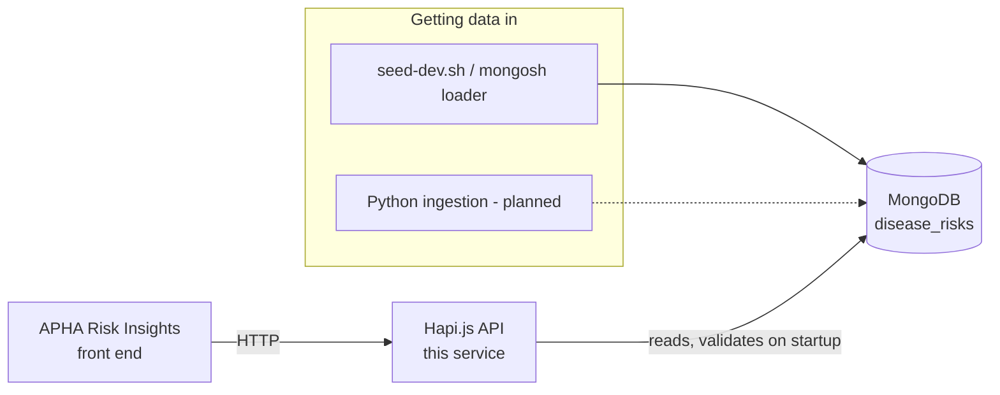

# APHA Risk Insights Backend

> **Work in progress.** The API endpoints are built, but the front end and real data ingestion are not
> finished yet. See [Work in progress](#work-in-progress).

This is the backend API for APHA Risk Insights. It serves disease risk assessments from MongoDB to the
APHA Risk Insights front end and to other consumers.

- [About the service](#about-the-service)
- [Front end](#front-end)
- [Quick start (Docker)](#quick-start-docker)
- [How the service works](#how-the-service-works)
- [Getting data in](#getting-data-in)
- [Using the API](#using-the-api)
- [Working on the service](#working-on-the-service)
- [Configuration](#configuration)
- [Architecture decisions](#architecture-decisions)
- [Deployment](#deployment)
- [Work in progress](#work-in-progress)
- [Licence](#licence)

## About the service

The backend is a [Hapi.js](https://hapi.dev/) API written in Node.js (ES modules) that uses MongoDB as its
store. It holds International Disease Monitoring risk assessments in one collection, `disease_risks`. Each
document is one disease risk, with its current status and its full history of earlier assessments.

Key facts:

- **Stack:** Node.js 24, Hapi.js, MongoDB 7, Docker Compose for local development.
- **Data:** the collection is validated by a MongoDB `$jsonSchema` validator that the API applies on startup.
  See [src/data/schemas/disease-risks.schema.json](src/data/schemas/disease-risks.schema.json).
- **API contract:** [docs/openapi/v1.yaml](docs/openapi/v1.yaml), served by the running service at
  `/documentation`. It is hand-written, not generated from code (see
  [hand-rolled-openapi-docs](adr/hand-rolled-openapi-docs.adr.md)).
- **Ingestion:** data is loaded with `mongosh` scripts today. A Python ingestion workload is planned in
  [ingestion/](ingestion/README.md).
- **Data status:** the only data in the repo is dummy data for development and tests. None of it is a real
  APHA risk assessment.

## Front end

The APHA Risk Insights front end is a separate service and consumes this API.

> **TODO:** add the front-end repository link and deployed URL here.

## Quick start (Docker)

Docker is the default way to run this service. You need [Docker](https://www.docker.com/) with Compose v2.
You do not need Node.js installed on your machine for this path.

```bash
git clone https://github.com/DEFRA/apha-risk-insights-backend.git
cd apha-risk-insights-backend

npm run docker:up:d                   # start the API, MongoDB and Floci in the background
ingestion/scripts/seed-dev.sh         # load the dummy disease risks into MongoDB
curl http://localhost:3001/health     # {"message":"success"}
```

Then open:

- API health: http://localhost:3001/health
- API documentation (Swagger UI): http://localhost:3001/documentation

Stop the stack when you have finished:

```bash
npm run docker:stop      # stop containers, keep MongoDB data
npm run docker:stop:v    # stop containers and delete MongoDB data (volume removed)
```

> The seed step needs the API to have started first, because the API creates the `disease_risks` validator.
> `docker:up:d` starts it, so the order above is correct.

## How the service works

The data flows in one direction: data is loaded into MongoDB, the API reads it, and the front end calls the API.



Service components:

| Component                        | Role                                                                                       |
| :------------------------------- | :----------------------------------------------------------------------------------------- |
| Hapi.js API (`src/`)             | Serves HTTP: health, the risk and disease endpoints, and the API docs.                     |
| MongoDB (`mongodb` service)      | Stores risks in `disease_risks`, with a `$jsonSchema` validator. Also holds `mongo-locks`. |
| `mongo-locks` collection         | Used by the app's lock helper for write locks across instances.                            |
| Floci (`floci` service)          | Local AWS emulator. Running, but no AWS resources are used yet.                            |
| Ingestion scripts (`ingestion/`) | Load data into `disease_risks` with `mongosh`. The Python workload is planned, not built.  |

On startup the API:

1. Validates its configuration (see [Configuration](#configuration)).
2. Connects to MongoDB and creates the `mongo-locks` index.
3. Creates or updates the `disease_risks` validator (`validationLevel: strict`, `validationAction: error`).
   Invalid writes are rejected.
4. Registers the routes and starts listening on port `3001` (in Docker).

## Getting data in

### Load the dummy dataset (development)

With the dev stack running:

```bash
ingestion/scripts/seed-dev.sh
```

This replaces everything in `disease_risks` with the contents of
[test/mocks/disease-risks.json](test/mocks/disease-risks.json). The same file is used by the tests.

To load another Extended JSON file, pass its path relative to the repo root. The file must be an object with
the documents under a `documents` key:

```bash
ingestion/scripts/seed-dev.sh path/to/file.json
```

What the script does:

- Runs `mongosh` in a throwaway `mongo` container on the `apha-risk` network, so it reaches the `mongodb`
  service. You do not need `mongosh` installed.
- Runs [ingestion/scripts/load-disease-risks.js](ingestion/scripts/load-disease-risks.js).
- Calls `deleteMany({})`, not `drop()`. Dropping the collection would also drop its validator.
- Refuses to load if the collection has no validator. Start the API first.
- Fails with `MongoServerError` code `121` if a document does not match the schema.

> **Warning:** the load replaces all documents in `disease_risks`. Do not point it at a shared environment.

### Load data by hand

`ingestion/scripts/load-disease-risks-inline.js` contains the dummy data inline. It can be pasted into a
`mongosh` session or run with `mongosh <uri> --file`. It has the same behaviour as the script above.

### Work in progress: real data ingestion

Real APHA data will come through the Python ingestion workload. It is not built yet. See
[ingestion/README.md](ingestion/README.md) and [python-ingestion-kept-separate](adr/python-ingestion-kept-separate.adr.md).

## Using the API

The API contract is the OpenAPI spec in [docs/openapi/v1.yaml](docs/openapi/v1.yaml). It describes every
endpoint, its parameters and its responses. Treat it as the source of truth for the front end and other consumers.

When the service is running locally, the spec is served at:

- Swagger UI: http://localhost:3001/documentation
- Raw YAML: http://localhost:3001/documentation/openapi.yaml

Errors are returned as problem details (`application/problem+json`). See
[return-errors-as-problem-details](adr/return-errors-as-problem-details.adr.md).

## Working on the service

### Ports

| Service        | Host port | Notes                                                                                               |
| :------------- | :-------- | :-------------------------------------------------------------------------------------------------- |
| API            | `3001`    | `PORT` in the container.                                                                            |
| Node inspector | `9229`    | Published by `docker:up` and `docker:debug`.                                                        |
| MongoDB        | `27017`   | Published by `docker:up` only. Connect with `mongodb://localhost:27017/apha-risk-insights-backend`. |
| Floci (AWS)    | `4566`    | Published by `docker:up` only.                                                                      |

### Compose files

| File                      | Purpose                                                                           |
| :------------------------ | :-------------------------------------------------------------------------------- |
| `compose.yaml`            | Base services: API, `floci`, `mongodb`. No published ports. Network: `apha-risk`. |
| `compose.override.yaml`   | Publishes the ports above. Loaded automatically by `docker compose up`.           |
| `compose.debug.yaml`      | Runs the API with the Node inspector and waits for a debugger before starting.    |
| `compose.test.yaml`       | Runs the test suite in its own container against its own `mongo-test` database.   |
| `compose.test.watch.yaml` | Runs the tests in Vitest watch mode.                                              |

Dev and test use separate Compose projects (`apha-risk-insights-backend` and
`apha-risk-insights-backend-test`), so they can run at the same time.

### Running on your machine (without Docker)

You need Node.js 24 (see [.nvmrc](.nvmrc)) and a MongoDB you can reach. With the dev stack running,
MongoDB is already available on `localhost:27017`.

```bash
nvm use
npm install
npm run dev              # API with --watch on port 3001, NODE_ENV=development
```

If you run the API on your machine, do not also run the Docker API on port `3001`.

Put overrides in a `.env` file at the repo root. `npm run dev`, `npm start` and the debug scripts load it when
it exists, for example:

```bash
MONGO_URI=mongodb://localhost:27017/
LOG_LEVEL=debug
```

### Debugging

- `npm run docker:debug` starts the API with the inspector on port `9229`. It waits for a debugger to attach
  before it runs. Attach from VS Code or Chrome DevTools to `localhost:9229`.
- `npm run dev:debug` does the same on your machine.

### Tests

Tests run against a real MongoDB container. There is no in-memory database.

```bash
npm run docker:test          # one-shot run in a clean test stack (recommended)
npm run docker:test:watch    # watch mode in the test stack
```

`docker:test` removes the test stack's volumes before it starts, so every run begins with an empty database.

> **Do not run `npm test` on your machine against the dev database.** The test setup empties every collection
> in the database it connects to after each run, so it would delete the dev data. Use the test stack.

Test layout (see [test/unit/README.md](test/unit/README.md) and [test/integration/README.md](test/integration/README.md)):

- `test/unit/`: one module in isolation, with I/O mocked. Mirrors `src/`.
- `test/integration/`: several modules against the real MongoDB container.
- `test/mocks/`: shared fixtures, including the dummy disease risks.
- `test/helpers/`: helpers such as `clearCollections()`.
- `src/**/*.test.js`: older tests kept beside their code. Move them into `test/` when you next change them.

### Code quality

Install [pre-commit](https://pre-commit.com/) once after cloning, then the hooks run on each commit:

```bash
pip install pre-commit   # or: pipx install pre-commit
pre-commit install
pre-commit run --all-files
```

The hooks run `detect-secrets` (checked against [.secrets.baseline](.secrets.baseline)), ESLint with `--fix`,
and Prettier. Husky is no longer used.

To check your changes before you push, run the audit, format check and lint on your machine, then the tests in
the test stack:

```bash
npm run security-audit
npm run format:check
npm run lint
npm run docker:test
```

`npm run check:all` runs all of these in one go, but its test step runs on your machine. Only use it with a
MongoDB you are happy to clear, or run the steps above instead.

### NPM scripts

Run `npm run` to list them all. The main ones:

| Script              | What it does                                                              |
| :------------------ | :------------------------------------------------------------------------ |
| `docker:up`         | Start the dev stack in the foreground.                                    |
| `docker:up:d`       | Start the dev stack in the background.                                    |
| `docker:build`      | Build the dev images.                                                     |
| `docker:debug`      | Start the dev stack with the Node inspector on `9229`.                    |
| `docker:stop`       | Stop the dev stack. Keeps MongoDB data.                                   |
| `docker:stop:v`     | Stop the dev stack and delete MongoDB data.                               |
| `docker:test`       | One-shot test run in a clean, isolated test stack.                        |
| `docker:test:watch` | Test run in watch mode, in the test stack.                                |
| `docker:dev`        | Runs inside the container. Same as `npm run dev`. Used by the Dockerfile. |
| `dev`               | Run the API with `--watch` on your machine, `NODE_ENV=development`.       |
| `dev:debug`         | As `dev`, with the inspector on `9229`, waiting for a debugger.           |
| `start`             | Run the API in production mode (`NODE_ENV=production`) on your machine.   |
| `test`              | Run the test suite with coverage. Needs a MongoDB you are happy to clear. |
| `test:watch`        | Run Vitest in watch mode. Same MongoDB caveat as `test`.                  |
| `lint`              | ESLint (neostandard) over `*.js` and `*.cjs`.                             |
| `lint:fix`          | `lint` with `--fix`.                                                      |
| `format`            | Prettier, write changes to `.js`, `.json` and `.md` files.                |
| `format:check`      | Prettier, check only.                                                     |
| `security-audit`    | `npm audit` for critical issues.                                          |
| `check:all`         | `security-audit`, `format:check`, `lint` and `test`, in order.            |

### Source layout

```
src/
  index.js              entry point
  server.js             creates the Hapi server and registers plugins
  config.js             convict config, read from environment variables
  plugins/              Hapi plugins: mongodb, router, logging, tracing, shutdown
  routes/               route definitions (health, documentation)
  data/                 MongoDB access: db.js (connection), collections.js (validators)
    schemas/            $jsonSchema for disease_risks
  common/helpers/       shared helpers: logging, locks, failAction, convict validators
docs/openapi/           hand-written API contract
ingestion/              data loading (mongosh today, Python planned)
compose/                Compose support files: Mongo init scripts, Floci start scripts
test/                   unit, integration, mocks and helpers
adr/                    architecture decision records
```

New code follows the existing layers. Add `data/`, `repos/` or `mappers/` modules only when a feature needs
them. See [AGENTS.md](AGENTS.md).

### Locks

Use the lock manager for writes that must not run at the same time across instances. It is available as
`server.locker` and `request.locker`:

```javascript
async function doStuff(server) {
  const lock = await server.locker.lock('unique-resource-name')

  if (!lock) {
    // Lock unavailable
    return
  }

  try {
    // do stuff
  } finally {
    await lock.free()
  }
}
```

Keep the locked section small. There are helpers in [src/common/helpers/mongo-lock.js](src/common/helpers/mongo-lock.js).

If you use `await using`, the lock is released automatically. Test coverage reports do not handle that syntax
yet.

### Updating dependencies

Use [npm-check-updates](https://github.com/raineorshine/npm-check-updates):

```bash
ncu --interactive --format group
```

After you change `package.json`, rebuild the images with `npm run docker:build`. The container does not pick up
dependency changes from the mounted files.

### Windows line endings

If Prettier reports line-ending problems on Windows, turn off Git's automatic line-ending conversion:

```bash
git config --global core.autocrlf false
```

## Configuration

Configuration is read from environment variables by [src/config.js](src/config.js). Defaults suit local
development.

| Variable                | Default                             | Purpose                                        |
| :---------------------- | :---------------------------------- | :--------------------------------------------- |
| `PORT`                  | `3001`                              | Port the API listens on.                       |
| `HOST`                  | `0.0.0.0`                           | Address the API binds to.                      |
| `MONGO_URI`             | `mongodb://127.0.0.1:27017/`        | MongoDB connection string.                     |
| `MONGO_DATABASE`        | `apha-risk-insights-backend`        | Database name.                                 |
| `MONGO_RETRY_WRITES`    | (from URI)                          | Overrides the retry-writes setting.            |
| `MONGO_READ_PREFERENCE` | (from URI)                          | `primary`, `secondary`, `nearest` and similar. |
| `NODE_ENV`              | (unset)                             | `development`, `test` or `production`.         |
| `LOG_ENABLED`           | `true` (`false` in test)            | Turns logging on or off.                       |
| `LOG_LEVEL`             | `info`                              | `fatal` to `trace`, or `silent`.               |
| `LOG_FORMAT`            | `pino-pretty` (`ecs` in production) | `ecs` or `pino-pretty`.                        |
| `ENVIRONMENT`           | `local`                             | CDP environment name.                          |
| `SERVICE_VERSION`       | (unset)                             | Injected by CDP.                               |
| `TRACING_HEADER`        | `x-cdp-request-id`                  | Header used for request tracing.               |
| `HTTP_PROXY`            | (unset)                             | Outbound HTTP proxy.                           |

The config is validated at startup in strict mode, so unknown values fail fast.

## Architecture decisions

Significant decisions are recorded in [adr/](adr/). Read them before you change the area they cover.

| ADR                                                                                   | Status     | Summary                                                    |
| :------------------------------------------------------------------------------------ | :--------- | :--------------------------------------------------------- |
| [access-mongo-through-data-db-module](adr/access-mongo-through-data-db-module.adr.md) | Accepted   | All Mongo access goes through `src/data/db.js`.            |
| [containerized-mongo-for-all-tests](adr/containerized-mongo-for-all-tests.adr.md)     | Accepted   | Tests use a real MongoDB container, never in-memory.       |
| [dual-layer-mongo-schema-validation](adr/dual-layer-mongo-schema-validation.adr.md)   | Superseded | Replaced by the next entry.                                |
| [validate-with-mongo-jsonschema-only](adr/validate-with-mongo-jsonschema-only.adr.md) | Accepted   | Schema validation is done by MongoDB `$jsonSchema`.        |
| [hand-rolled-openapi-docs](adr/hand-rolled-openapi-docs.adr.md)                       | Accepted   | OpenAPI is written by hand and served at `/documentation`. |
| [keep-floci-only-from-aws-stack](adr/keep-floci-only-from-aws-stack.adr.md)           | Accepted   | Floci is the only AWS emulator carried over.               |
| [return-errors-as-problem-details](adr/return-errors-as-problem-details.adr.md)       | Accepted   | Errors are returned as `application/problem+json`.         |
| [python-ingestion-kept-separate](adr/python-ingestion-kept-separate.adr.md)           | Accepted   | Python ingestion lives in `ingestion/`, built separately.  |

## Deployment

The production image is built from the same `Dockerfile` (the `production` stage). It installs production
dependencies only and runs `node src`.

```bash
docker build --no-cache --tag apha-risk-insights-backend .
docker run -e PORT=3001 -p 3001:3001 apha-risk-insights-backend
```

CI runs on pull requests to `main` ([check-pull-request.yml](.github/workflows/check-pull-request.yml)). It runs
the security audit, the format check, lint and the test stack, then builds the image. A push to `main` runs
[publish.yml](.github/workflows/publish.yml). Hotfixes are published by hand through
[publish-hotfix.yml](.github/workflows/publish-hotfix.yml).

The service runs behind the CDP forward proxy. Node.js 24 routes outbound HTTP(S) through it when the
environment sets `NODE_USE_ENV_PROXY=1`, `HTTPS_PROXY` and `NO_PROXY`. The service needs no extra proxy
configuration.

> **TODO:** document the deployment environments and where the service is hosted.

SonarCloud is set up in [sonar-project.properties](sonar-project.properties), but the scan steps in the workflows
are commented out.

## Work in progress

Known gaps. Check here before you assume something works.

- **Real data.** Only dummy data is loaded. The Python ingestion workload is not built. `ingestion/` holds
  mongosh scripts only.
- **Floci.** Running in the stack, but no S3, SQS or SNS resources are created or used yet.
- **Authentication.** The API contract has no security scheme (`security: []`). Decide access control before
  real data is served.
- **Front end link.** See [Front end](#front-end).
- **Deployment details.** See the TODO in [Deployment](#deployment).

## Licence

THIS INFORMATION IS LICENSED UNDER THE CONDITIONS OF THE OPEN GOVERNMENT LICENCE found at:

<http://www.nationalarchives.gov.uk/doc/open-government-licence/version/3>

The following attribution statement MUST be cited in your products and applications when using this information.

> Contains public sector information licensed under the Open Government license v3

### About the licence

The Open Government Licence (OGL) was developed by the Controller of Her Majesty's Stationery Office (HMSO) to enable
information providers in the public sector to license the use and re-use of their information under a common open
licence.

It is designed to encourage use and re-use of information freely and flexibly, with only a few conditions.
